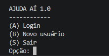
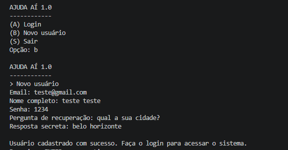
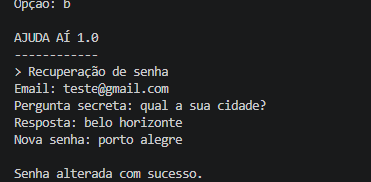
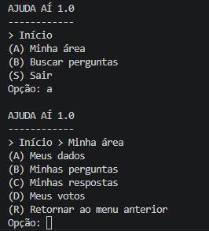
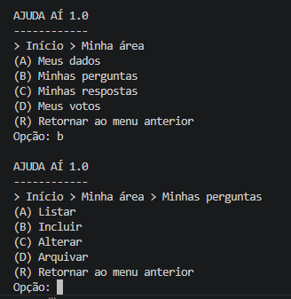
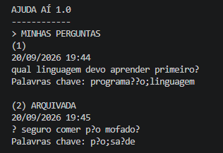

# AJUDA AÍ 1.0

Trabalhos Práticos 1 e 2 da disciplina **Algoritmos e Estruturas de Dados III**.

O projeto implementa um sistema de perguntas e respostas em interface textual, com persistência em arquivos. O **TP1** trouxe o CRUD de usuários, o CRUD de perguntas, autenticação, recuperação de senha e o relacionamento 1:N entre usuários e perguntas. O **TP2** acrescenta a busca paginada das perguntas mais recentes, as respostas, as avaliações e o relacionamento N:N entre usuários e perguntas (ver a seção [TP2 – Relacionamento N:N](#tp2--relacionamento-nn)).

## Participantes

- **Rafael Caricatti**
- **Renan Vieira**
- **Savio Faria**
- **Letícia Gonçalves Farias** 

## Descrição do sistema

O **AJUDA AÍ 1.0** é uma aplicação Java executada pelo terminal. Nesta etapa do projeto, o sistema permite cadastrar usuários, realizar login, recuperar a senha por meio de uma pergunta secreta, alterar os dados do usuário e gerenciar as perguntas vinculadas à conta autenticada.

Cada pergunta pertence a um único usuário por meio do atributo `idUsuario`. O caminho inverso, isto é, descobrir todas as perguntas pertencentes a determinado usuário, é realizado com uma **Árvore B+** persistente, utilizando o par `[idUsuario, idPergunta]`.

O sistema também utiliza uma **Tabela Hash Extensível** como índice indireto de e-mail dos usuários, permitindo localizar o usuário a partir de seu e-mail sem percorrer sequencialmente o arquivo principal.

No TP1, as opções **Buscar perguntas**, **Minhas respostas** e **Minhas avaliações** apareciam nos menus apenas como parte da estrutura geral da aplicação. Elas foram implementadas no TP2. Somente a **Busca por palavras-chave** continua reservada para uma etapa posterior, conforme o enunciado do TP2.

## Funcionalidades implementadas

### Usuários

O sistema permite:

- cadastrar um novo usuário;
- impedir o cadastro de e-mails duplicados;
- realizar login por e-mail e senha;
- armazenar senha por meio de hash SHA-256;
- armazenar a resposta secreta também por hash;
- normalizar a resposta secreta antes da geração do hash, removendo acentos e convertendo o texto para letras minúsculas;
- recuperar a senha utilizando a pergunta e a resposta secreta;
- alterar nome;
- alterar e-mail;
- alterar senha;
- alterar pergunta e resposta de recuperação.

### Perguntas

O usuário autenticado pode:

- listar suas próprias perguntas;
- incluir uma pergunta;
- alterar o texto e as palavras-chave de uma pergunta ativa;
- arquivar uma pergunta;
- continuar visualizando suas perguntas arquivadas;
- visualizar as perguntas por uma numeração sequencial, sem exposição dos IDs internos.

O arquivamento é definitivo. Em vez de excluir fisicamente a pergunta, o atributo `ativa` recebe o valor `false`. Dessa forma, a pergunta continua associada ao seu autor e pode ser identificada na listagem como **ARQUIVADA**.

## Classes principais

| Classe | Responsabilidade |
|---|---|
| `Main` | Ponto de entrada da aplicação. |
| `InterfaceSistema` | Interface textual, menus, navegação e integração das funcionalidades. |
| `Usuario` | Entidade de usuário e sua serialização. |
| `Pergunta` | Entidade de pergunta e sua serialização. |
| `ArquivoUsuario` | CRUD especializado de usuários e índice indireto por e-mail. |
| `ControladorUsuario` | Cadastro, login, recuperação de senha e regras de usuário. |
| `ParEmailIdUsuario` | Par utilizado no índice extensível de e-mail para ID do usuário. |
| `Seguranca` | Geração de hash SHA-256 e normalização da resposta secreta. |
| `ArquivoPergunta` | CRUD especializado de perguntas e relacionamento usuário-pergunta. |
| `GerenciadorPerguntas` | Regras de inclusão, alteração, arquivamento e listagem das perguntas. |
| `aed3.Arquivo` | CRUD genérico utilizado como base, conforme disponibilizado na disciplina. |
| `aed3.HashExtensivel` | Tabela Hash Extensível utilizada nos índices. |
| `aed3.ArvoreBMais` | Árvore B+ disponibilizada pelo professor e utilizada no relacionamento 1:N. |
| `aed3.ParIdId` | Par de IDs utilizado na Árvore B+ para `[idUsuario, idPergunta]`. |
| `TestePerguntas` | Testes das operações de perguntas. |
| `TesteIntegracao` | Teste integrado das principais funcionalidades do sistema. |
| `Resposta` | **(TP2)** Entidade de resposta (`idResposta`, `idPergunta`, `idUsuario`, `criacao`, `resposta`, `nota`, `avaliacoes`, `ativa`). |
| `Avaliacao` | **(TP2)** Entidade de avaliação (`idAvaliacao`, `idUsuario`, `idResposta`, `avaliacao`). |
| `ArquivoResposta` | **(TP2)** CRUD de respostas com as Árvores B+ `[idPergunta, idResposta]` e `[idUsuario, idResposta]`. |
| `ArquivoAvaliacao` | **(TP2)** CRUD de avaliações com as Árvores B+ `[idUsuario, idAvaliacao]` e `[idResposta, idAvaliacao]`. |
| `GerenciadorRespostas` | **(TP2)** Regras de negócio: responder, avaliar, arquivar, moderar, cancelar avaliação e listagens. |
| `MenuBuscaPerguntas` | **(TP2)** Telas de busca: perguntas mais recentes paginadas, pergunta com respostas e responder. |
| `MenuResposta` | **(TP2)** Tela de uma resposta: avaliar, arquivar a própria resposta ou moderar (autor da pergunta). |
| `MenuMinhasInteracoes` | **(TP2)** Telas "Minhas respostas" e "Minhas avaliações" da área do usuário. |
| `aed3.ParDataId` | **(TP2)** Par `[data de criação, idPergunta]` da Árvore B+ de datas, ordenado de forma decrescente. |
| `TesteInteracoes` | **(TP2)** Testes de respostas, avaliações, cancelamento, moderação e persistência. |

## Operações especiais implementadas

### Índice de e-mail

A classe `ArquivoUsuario` estende `Arquivo<Usuario>` e mantém um índice indireto por e-mail com `HashExtensivel<ParEmailIdUsuario>`.

Ao cadastrar um usuário, o sistema verifica se o e-mail já está presente no índice. Na alteração de e-mail, a entrada antiga é removida e uma nova associação é criada com o novo e-mail e o mesmo ID do usuário.

### Segurança das senhas

A classe `Seguranca` utiliza **SHA-256** para gerar os hashes de senha e de resposta secreta.

Antes do hash da resposta secreta, o texto é normalizado por meio de `Normalizer`, removendo acentos, convertendo para letras minúsculas e removendo espaços excedentes nas extremidades. Isso possibilita comparar respostas equivalentes de maneira padronizada.

### Relacionamento 1:N

A classe `ArquivoPergunta` estende `Arquivo<Pergunta>` e utiliza a implementação de **Árvore B+ fornecida pelo professor**.

O relacionamento é armazenado com:

```text
[idUsuario, idPergunta]
```

Assim, um usuário pode possuir várias perguntas, enquanto cada pergunta possui apenas um `idUsuario`.

Quando uma pergunta é criada, o relacionamento também é incluído na árvore. Para listar as perguntas de um usuário, a aplicação consulta a Árvore B+ pelo `idUsuario` e recupera os IDs das perguntas associadas.

### Numeração sequencial na interface

Os IDs de usuário e de pergunta são utilizados apenas internamente. Na tela, as perguntas são exibidas como `(1)`, `(2)`, `(3)` etc.

Durante as operações de alteração e arquivamento, a interface mantém a associação entre o número mostrado ao usuário e o verdadeiro `idPergunta`, permitindo realizar a operação correta sem expor identificadores internos.

### Arquivamento

As perguntas não são excluídas pela interface. O método de arquivamento altera o campo:

```text
ativa = false
```

A pergunta continua vinculada ao usuário na Árvore B+, permitindo que o autor ainda a visualize com a indicação **ARQUIVADA**.

## Capturas de tela

### 1. Menu inicial



Tela inicial do sistema com as opções de login, novo usuário e saída.

### 2. Cadastro de usuário



Confirmação de que um novo usuário foi cadastrado com sucesso.

### 3. Login e recuperação de senha



Tela exibida após uma tentativa de login incorreta, mostrando a possibilidade de recuperar a senha.

### 4. Minha área



Menu da área pessoal do usuário, contendo o acesso aos dados e às perguntas.

### 5. Menu de perguntas



Menu de gerenciamento das perguntas, com as operações de listar, incluir, alterar e arquivar.

### 6. Listagem de perguntas



Listagem das perguntas do usuário com numeração sequencial, palavras-chave e pelo menos uma pergunta marcada como **ARQUIVADA**, sem exibição dos IDs internos.

## TP2 – Relacionamento N:N

### Descrição

No TP2, o usuário passa a consultar as perguntas publicadas por **qualquer** usuário, responder a essas perguntas e avaliar as respostas dos outros. Cada resposta é ligada tanto à pergunta que responde (`idPergunta`) quanto ao usuário que a escreveu (`idUsuario`). Assim, a entidade `Resposta` fica entre `Usuario` e `Pergunta` e forma o relacionamento **N:N** (N usuários respondem a N perguntas), representado por dois relacionamentos 1:N:

```text
USUÁRIO 1 ──── N RESPOSTA N ──── 1 PERGUNTA
```

Da mesma forma, a entidade `Avaliacao` liga um usuário a uma resposta que ele avaliou e impede que a mesma resposta seja avaliada duas vezes pelo mesmo usuário.

### Funcionalidades implementadas no TP2

**Buscar perguntas (menu principal, opção B)**

- listagem das perguntas ativas de todos os usuários, da mais recente para a mais antiga, com **5 perguntas por página** e as opções *Página anterior* e *Próxima página*;
- tela da pergunta selecionada com as respostas ativas ordenadas pela **nota, em ordem decrescente**;
- opção *Responder à pergunta*: o usuário digita apenas o texto. `idUsuario`, `idPergunta`, data de criação, `nota = 0`, `avaliacoes = 0` e `ativa = true` são preenchidos automaticamente;
- tela de uma resposta: se a resposta é do próprio usuário, a única opção é *Arquivar resposta*; caso contrário, ele pode *Concordar* (+1 na nota) ou *Discordar* (−1 na nota), e a quantidade de avaliações é incrementada.

**Área do usuário**

- **(B) Minhas perguntas:** ao listar, o usuário pode abrir uma pergunta e ver as respostas recebidas, ordenadas por nota. Nessa tela continuam as opções do TP1 (*Alterar dados da pergunta* e *Arquivar pergunta*). Ao abrir a resposta de outro usuário, o autor da pergunta pode **arquivá-la** (moderação de respostas incompatíveis com a pergunta ou com as regras de ética);
- **(C) Minhas respostas:** lista as respostas ativas escritas pelo usuário. Ao selecionar uma, são mostradas a pergunta e a resposta, com a opção *Arquivar resposta*;
- **(D) Minhas avaliações:** lista as respostas avaliadas pelo usuário. Ao selecionar uma, são mostradas a pergunta, a resposta e a avaliação feita (positiva ou negativa), com a opção *Cancelar avaliação*.

Respostas, assim como perguntas, **não são excluídas**: o arquivamento altera `ativa = false`, e a resposta deixa de aparecer nas listagens.

### Operações especiais do TP2

#### Árvore B+ de datas (perguntas mais recentes)

`ArquivoPergunta` ganhou uma segunda Árvore B+, `indiceDataPergunta`, com pares `ParDataId` no formato `[criacao, idPergunta]`. O `compareTo` de `ParDataId` compara as datas de forma **invertida**, de modo que a árvore já fica em ordem **decrescente de data**. Em caso de datas iguais, o maior `idPergunta` (criado depois) vem primeiro.

A árvore é atualizada em `create`, `update` (se a data mudar) e `delete`. Se o arquivo do índice ainda não existir (dados criados no TP1), ele é reconstruído automaticamente a partir da árvore `[idUsuario, idPergunta]`. A listagem (`readAllByData`) percorre a árvore em ordem, descarta as perguntas arquivadas, e `MenuBuscaPerguntas` divide o resultado em páginas de 5.

#### Árvores B+ do relacionamento N:N

`ArquivoResposta` mantém duas Árvores B+ com `ParIdId`:

| Árvore | Par | Uso |
|---|---|---|
| `relPerguntaResposta` | `[idPergunta, idResposta]` | Respostas de uma pergunta (busca e "Minhas perguntas"). |
| `relUsuarioResposta` | `[idUsuario, idResposta]` | Respostas escritas por um usuário ("Minhas respostas"). |

`ArquivoAvaliacao` mantém outras duas: `relUsuarioAvaliacao` `[idUsuario, idAvaliacao]` ("Minhas avaliações" e trava contra voto duplo) e `relRespostaAvaliacao` `[idResposta, idAvaliacao]`.

Os métodos `create` e `delete` dos dois CRUDs incluem e removem os pares nas árvores junto com o registro, mantendo os índices consistentes com os arquivos de dados.

#### Avaliação e trava contra voto duplo

`GerenciadorRespostas.votar` verifica, nesta ordem: se a resposta existe, se está ativa, se não é do próprio usuário e se o usuário ainda não a avaliou (consulta pela árvore `[idUsuario, idAvaliacao]`). Só então grava a `Avaliacao` e ajusta a `Resposta` (`nota ± 1`, `avaliacoes + 1`).

#### Cancelamento de avaliação

`GerenciadorRespostas.cancelarAvaliacao` confere se a avaliação pertence ao usuário, **reverte o efeito do voto** na resposta (subtrai 1 da nota se foi positiva, soma 1 se foi negativa, e decrementa `avaliacoes`) e depois **exclui** o registro da avaliação e seus pares nas duas árvores. Com isso, a avaliação não pode ser "alterada": para mudar de opinião, o usuário cancela e avalia novamente.

#### Moderação pelo autor da pergunta

`GerenciadorRespostas.arquivarRespostaDaPergunta` só permite o arquivamento se o usuário logado for o autor da pergunta **e** se a resposta pertencer a essa pergunta. O arquivamento da própria resposta (`arquivarResposta`) só é permitido ao autor da resposta.

### Capturas de tela do TP2

#### Perguntas mais recentes (paginação)

```text
AJUDA AÍ 1.0
------------
> Início > Buscar perguntas > Perguntas mais recentes

(1) Por que sentimos mais sono depois do almoco?
    Criada por Ana Souza em 19/10/2026 às 09:09

(2) Por que o ceu e azul?
    Criada por Ana Souza em 19/10/2026 às 09:09

(3) Por que o cafe perde o efeito quando consumido todo dia?
    Criada por Ana Souza em 19/10/2026 às 09:09

(4) E necessario fechar os aplicativos em segundo plano?
    Criada por Ana Souza em 19/10/2026 às 09:09

(5) Por que algumas pessoas trabalham melhor ouvindo musica?
    Criada por Ana Souza em 19/10/2026 às 09:09

Página 1 de 2

(A) Página anterior
(B) Próxima página

(R) Retornar
Opção: B

AJUDA AÍ 1.0
------------
> Início > Buscar perguntas > Perguntas mais recentes

(1) Carregar o celular durante a noite prejudica a bateria?
    Criada por Ana Souza em 19/10/2026 às 09:09

Página 2 de 2
```

#### Pergunta com respostas

```text
AJUDA AÍ 1.0
------------
> Início > Buscar perguntas > Perguntas mais recentes > Pergunta

Por que sentimos mais sono depois do almoco?
Criada por Ana Souza em 19/10/2026 às 09:09

RESPOSTAS
---------

(1) Porque o corpo gasta energia para fazer a digestao.
Respondido por Beto Lima em 19/10/2026 às 09:09
Nota: 0 (0 avaliações)

(2) Porque a gente quer enrolar com o trabalho.
Respondido por Carla Dias em 19/10/2026 às 09:09
Nota: 0 (0 avaliações)

(A) Responder à pergunta

(R) Retornar
```

#### Avaliação de uma resposta de outro usuário

```text
AJUDA AÍ 1.0
------------
> Início > Buscar perguntas > Perguntas mais recentes > Pergunta > Resposta

Por que sentimos mais sono depois do almoco?
Criada por você em 19/10/2026 às 09:09

RESPOSTA
--------

Porque o corpo gasta energia para fazer a digestao.
Respondido por Beto Lima em 19/10/2026 às 09:09
Nota: 1  (1 avaliações)

(A) Concordar com a resposta
(B) Discordar da resposta

(R) Retornar ao menu anterior
```

#### Minhas avaliações e cancelamento

```text
AJUDA AÍ 1.0
------------
> Início > Minha área > Minhas avaliações > Avaliação

Por que sentimos mais sono depois do almoco?
Criada por Ana Souza em 19/10/2026 às 09:09

RESPOSTA
--------

Porque o corpo gasta energia para fazer a digestao.
Respondido por Beto Lima em 19/10/2026 às 09:09
Nota: 1  (1 avaliações)

SUA AVALIAÇÃO: CONCORDOU (POSITIVA)

(A) Cancelar avaliação

(R) Retornar ao menu anterior

Opção: A
Confirmar cancelamento da avaliação? (S/N): S

Avaliação cancelada. A nota da resposta foi ajustada.
```

#### Minhas perguntas: moderação de resposta de outro usuário

```text
AJUDA AÍ 1.0
------------
> Início > Minha área > Minhas perguntas > Pergunta > Resposta

Por que sentimos mais sono depois do almoco?
Criada por você em 19/10/2026 às 09:09

RESPOSTA
--------

Porque a gente quer enrolar com o trabalho.
Respondido por Carla Dias em 19/10/2026 às 09:09
Nota: 0  (0 avaliações)

(A) Arquivar resposta

(R) Retornar ao menu anterior

Opção: A
Confirmar arquivamento? (S/N): S

Resposta arquivada com sucesso.
```

#### Minhas respostas

```text
AJUDA AÍ 1.0
------------
> Início > Minha área > Minhas respostas > Resposta

Por que sentimos mais sono depois do almoco?
Criada por Ana Souza em 19/10/2026 às 09:09

RESPOSTA
--------

Porque o corpo gasta energia para fazer a digestao.
Respondido por você em 19/10/2026 às 09:09
Nota: 0  (0 avaliações)

(A) Arquivar resposta

(R) Retornar ao menu anterior
```

### Vídeo de demonstração do TP2

Link: _(adicionar o link do vídeo do TP2 aqui)_

### Checklist obrigatório – TP2

#### Há uma listagem paginada de perguntas, que mostra as perguntas em ordem decrescente de data a partir de uma Árvore B+ acrescentada ao CRUD de Perguntas?

**Sim.** `ArquivoPergunta` possui a Árvore B+ `indiceDataPergunta` com pares `ParDataId` `[criacao, idPergunta]`, cujo `compareTo` ordena as datas de forma decrescente. `MenuBuscaPerguntas` exibe 5 perguntas por página, com *Página anterior* e *Próxima página*.

#### Há uma listagem das respostas a uma pergunta selecionada, em ordem decrescente de nota?

**Sim.** As respostas são obtidas pela Árvore B+ `[idPergunta, idResposta]`, filtradas para mostrar apenas as ativas e ordenadas por nota decrescente em `GerenciadorRespostas.listarRespostasDaPergunta`.

#### O usuário pode responder a uma pergunta?

**Sim.** Pela opção *Responder à pergunta*. O usuário digita só o texto; os demais atributos são preenchidos automaticamente, e a resposta é incluída nas duas Árvores B+ do relacionamento.

#### O usuário pode arquivar a própria resposta?

**Sim.** Ao abrir uma resposta própria (na busca ou em *Minhas respostas*), a única opção é *Arquivar resposta*, que define `ativa = false`.

#### O usuário pode avaliar uma resposta?

**Sim.** Em respostas de outros usuários há as opções *Concordar* (+1) e *Discordar* (−1), que também incrementam a quantidade de avaliações. O sistema impede avaliar a própria resposta, avaliar uma resposta arquivada e avaliar a mesma resposta duas vezes.

#### Na área do usuário, o usuário pode visualizar as respostas às suas perguntas?

**Sim.** Em *Minhas perguntas > Listar*, ao escolher uma pergunta, são exibidas as respostas recebidas, ordenadas por nota.

#### Na área do usuário, o usuário pode arquivar uma resposta de outro usuário a uma das suas perguntas?

**Sim.** Na tela da pergunta em *Minhas perguntas*, o autor pode abrir uma resposta e escolher *Arquivar resposta*. A regra (`arquivarRespostaDaPergunta`) confere que o usuário é o autor da pergunta e que a resposta pertence a ela.

#### Na área do usuário, o usuário pode visualizar e arquivar as respostas que escreveu?

**Sim.** Em *Minhas respostas*, listadas pela Árvore B+ `[idUsuario, idResposta]`. Ao selecionar uma, a pergunta e a resposta são exibidas com a opção *Arquivar resposta*.

#### Na área do usuário, o usuário pode visualizar e arquivar a avaliação que realizou em uma resposta?

**Sim.** Em *Minhas avaliações*, o usuário vê a pergunta, a resposta e a avaliação feita, e pode *Cancelar avaliação*. O cancelamento reverte a nota e a quantidade de avaliações da resposta e exclui o registro da avaliação.

#### A integridade do relacionamento entre perguntas e respostas está mantida em todas as operações?

**Sim.** Toda resposta é criada com o `idPergunta` da pergunta selecionada, e o par `[idPergunta, idResposta]` é gravado junto com o registro (o mesmo vale para `[idUsuario, idResposta]`). Como perguntas e respostas são apenas arquivadas, os pares continuam válidos; o `delete` do CRUD também remove os pares das árvores. Respostas arquivadas não aparecem nas listagens, e perguntas arquivadas não aparecem na busca.

#### A integridade do relacionamento entre respostas e avaliações está mantida em todas as operações?

**Sim.** Cada avaliação é gravada com os pares `[idUsuario, idAvaliacao]` e `[idResposta, idAvaliacao]`, e a nota e a quantidade de avaliações da resposta são ajustadas no mesmo fluxo. No cancelamento, a resposta é ajustada antes da exclusão da avaliação e de seus pares. O teste `TesteInteracoes` verifica esses ajustes, inclusive após fechar e reabrir os arquivos.

#### O trabalho compila corretamente?

**Sim.** Todo o projeto compila com `javac -encoding UTF-8 aed3/*.java *.java`, e os testes `TesteInteracoes`, `TestePerguntas`, `TesteCRUD` e `TesteIntegracao` executam com sucesso.

#### O trabalho está completo e funcionando sem erros de execução?

**Sim, considerando o escopo do TP2.** Todas as operações pedidas foram implementadas e testadas pela interface. A *Busca por palavras-chave* aparece no menu, mas, como indicado no enunciado, não faz parte deste TP.

#### O trabalho é original e não a cópia de um trabalho de outro grupo?

**Sim.** As entidades, os CRUDs, as regras de negócio e as telas foram desenvolvidos pelo grupo. As estruturas genéricas fornecidas pelo professor (`Arquivo`, `HashExtensivel`, `ArvoreBMais`) foram usadas conforme exigido.


## Como compilar e executar

A partir da pasta `CRUD2`:

```bash
javac -encoding UTF-8 aed3/*.java *.java
```

Para executar a aplicação:

```bash
java Main
```

Para executar os testes de perguntas:

```bash
java TestePerguntas
```

Para executar o teste de integração:

```bash
java TesteIntegracao
```

Para executar os testes de respostas e avaliações (TP2):

```bash
java TesteInteracoes
```

## Checklist obrigatório – TP1

### Há um CRUD de usuários (que estende a classe Arquivo, acrescentando Tabelas Hash Extensíveis e Árvores B+ como índices diretos e indiretos conforme necessidade) que funciona corretamente?

**Sim.** A classe `ArquivoUsuario` estende `Arquivo<Usuario>` e utiliza uma Tabela Hash Extensível para o índice indireto de e-mail. As operações de criação, consulta, atualização e exclusão estão integradas ao CRUD genérico.

### Há um CRUD de perguntas (que estende a classe Arquivo, acrescentando Tabelas Hash Extensíveis e Árvores B+ como índices diretos e indiretos conforme necessidade) que funciona corretamente?

**Sim.** A classe `ArquivoPergunta` estende `Arquivo<Pergunta>` e utiliza a Árvore B+ para manter o relacionamento entre usuário e pergunta. As operações de criação, consulta, atualização e exclusão existem no CRUD, enquanto a interface utiliza arquivamento em vez de exclusão física.

### As perguntas estão vinculadas aos usuários usando o idUsuario como chave estrangeira?

**Sim.** A entidade `Pergunta` possui o atributo `idUsuario`, preenchido automaticamente com o ID do usuário autenticado no momento do cadastro da pergunta.

### Há uma árvore B+ que registre o relacionamento 1:N entre usuários e perguntas?

**Sim.** O relacionamento é mantido pela classe `aed3.ArvoreBMais`, utilizando objetos `ParIdId` no formato `[idUsuario, idPergunta]`.

### O trabalho compila corretamente?

**Sim.** O projeto foi compilado em conjunto com as classes do pacote `aed3`, incluindo as classes de usuários, perguntas, interface e testes.

### O trabalho está completo e funcionando sem erros de execução?

**Sim, considerando o escopo definido para este TP.** As funcionalidades exigidas nesta etapa — usuários, autenticação, recuperação de senha, dados pessoais, gerenciamento de perguntas e relacionamento 1:N — estão integradas. As funcionalidades de busca de perguntas, respostas e votos são apresentadas apenas como opções de menu e estão reservadas para etapas posteriores do projeto.

### O trabalho é original e não a cópia de um trabalho de outro grupo?

**Sim.** A implementação das entidades, controles, integração e interface foi desenvolvida pelo grupo. As classes genéricas de estruturas de dados fornecidas pelo professor foram utilizadas conforme exigência do próprio trabalho prático.

## Observações finais

O sistema foi organizado de forma a separar as entidades, o acesso aos arquivos, as regras de negócio e a interface textual. A utilização do CRUD genérico, da Tabela Hash Extensível e da Árvore B+ permite manter os dados persistentes e os relacionamentos necessários para esta etapa do projeto.
